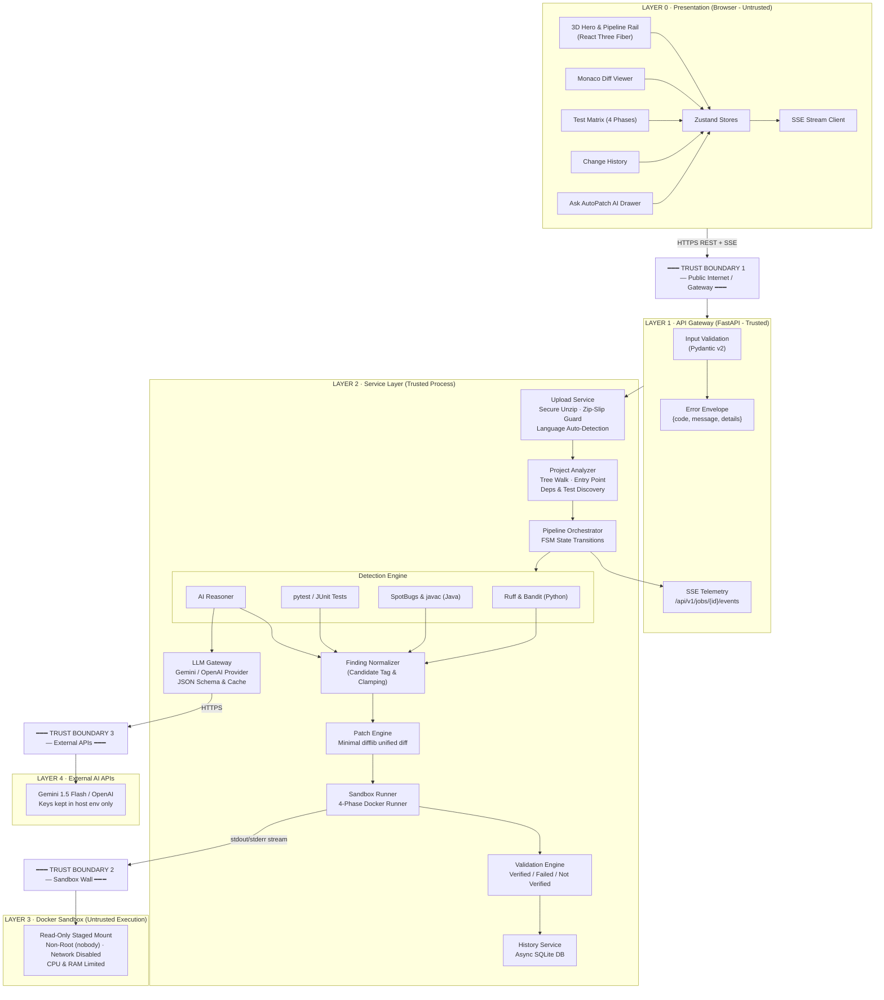
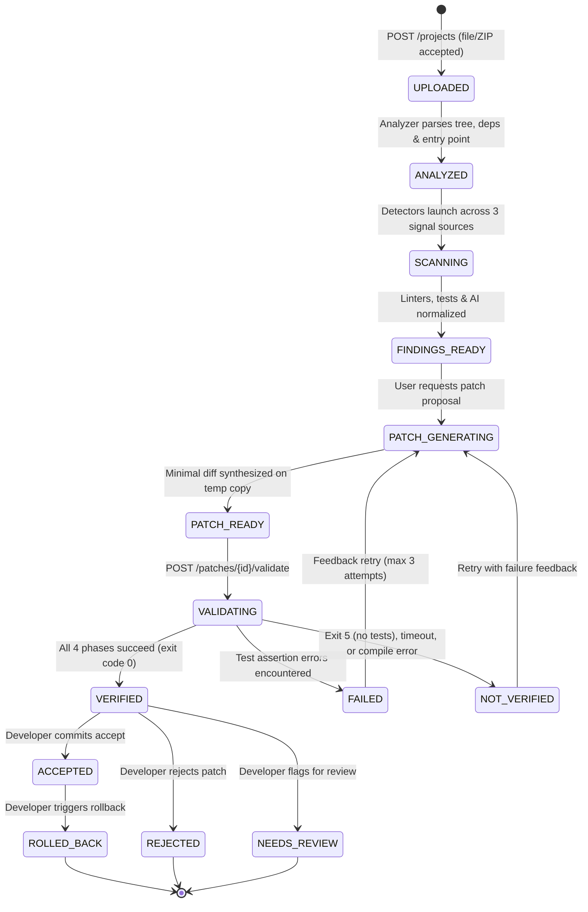
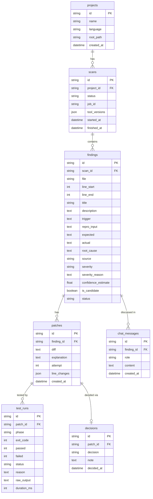
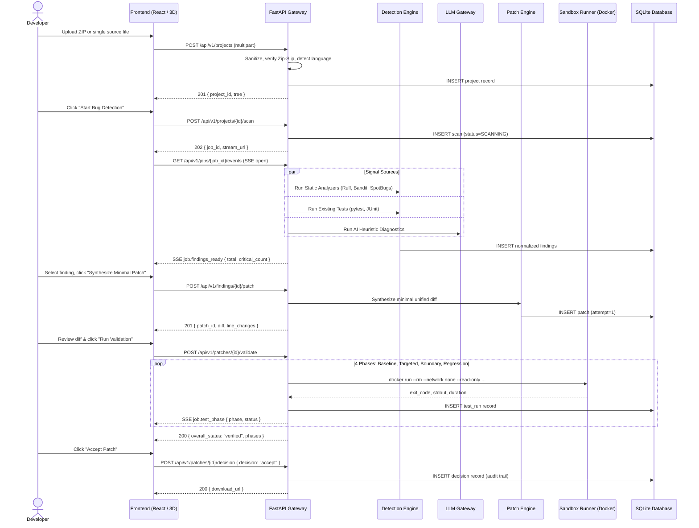

# AutoPatch — System Architecture & Workflow Diagrams

---

## 1. Layered Architecture & Trust Boundaries

---

## 2. Pipeline State Machine

---

## 3. Entity-Relationship Diagram (SQLAlchemy Models)

---

## 4. End-to-End Bug → Patch → Verify Sequence

